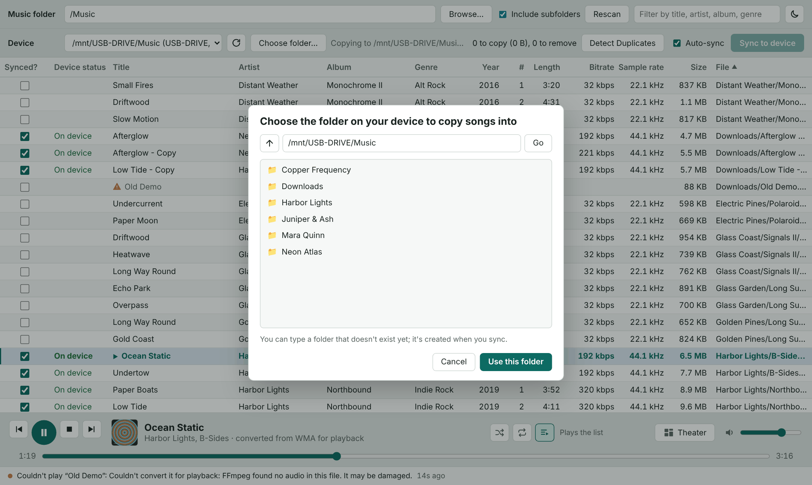
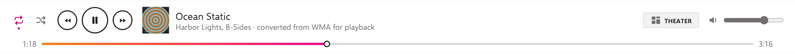

# MusicSync (local web app)

Web app created with Claude. Nothing fancy and needs some more work. A
small Python server on your PC reads your music folder, streams songs to the
page, and copies/removes songs on your external drive. It only listens on
`127.0.0.1`, so nothing else on your network can reach it.

## Screenshots

| Dark mode | Detect Duplicates |
|---|---|
|  |  |
| **Right-click menu** | **Folder picker** |
|  |  |

Player with shuffle on and repeat set to forever:

The screenshots use a made-up demo library.

## Start it

1. Install **Python 3.10 or newer** from https://www.python.org/downloads/
   (the Python Install Manager or the classic installer both work).
2. Double-click **start.bat**. The first run installs the packages MusicSync
   needs into a `.venv` folder. They're bundled in the `wheels` folder, so no
   internet is needed (see "Offline install" below).
3. MusicSync starts in the **system tray** (by the clock; on Windows 11 it may
   be under the ^ arrow) and opens in your browser.
   - Click the tray icon to open MusicSync again after closing the browser tab.
   - Right-click it for **Show log file** and **Quit MusicSync**.
   - Running `start.bat` while MusicSync is already running just opens it.
   - To keep the icon always visible, drag it from under the ^ arrow onto
     the taskbar.

Prefer a console window? Use **start-console.bat** instead (Ctrl+C stops it).

Manual start on any OS:

    pip install -r requirements.txt
    python server.py              # tray icon
    python server.py --console    # console window

Use `MUSICSYNC_PORT=9000` to change the port, or `--no-browser` to skip opening
the browser.

## Using it

- **Music folder → Browse…** opens a folder picker. Click a column header to
  sort; type in the filter box to narrow the list.
- **Playing:** double-click a song or press Enter. The list's current sort and
  filter order is the play order. Keyboard media keys work too. Three buttons
  next to the player set how it plays, with a short description beside them:
  - **Shuffle** (off by default): random order, reshuffled on each repeat.
  - **Repeat** (off by default): click to cycle off → once (badge "1") →
    forever (badge "∞").
  - **Auto-advance** (on by default): go on to the next song when one ends.
    With it on, repeat applies to the whole list (once = list plays twice).
    With it off, repeat applies to the current song (once = song plays twice).
- **Light/dark:** the sun/moon button at the top right switches themes. Until
  you use it, the app follows your Windows setting.
- **Device:** pick a drive (songs go into `X:\Music\`) or **Choose folder…**.
  The list then shows the mapped folder, and songs already there are ticked.
  The folder is remembered: if the drive isn't plugged in, the app says so and
  reconnects by itself within a few seconds of you plugging it in (or press
  the refresh button). Your ticks are kept while it's unplugged.
- **Ticking songs:** use the *On device?* checkboxes, or highlight rows
  (Shift/Ctrl-click, Ctrl+A) and press Space. Right-click for more options.
  The *Device status* column shows **To copy**, **On device** or **To remove**.
  Nothing on the drive changes until you press **Sync to device**.

A song counts as on the device when a file with the same path (relative to your
music folder) and the same size is in the device folder. Only files in the
device folder are ever deleted, and the app refuses a device folder that
overlaps your music folder.

## Library index

What’s stored: each file’s size, modified time and tags, plus whether you ticked it for the device. It lives in %AppData%\MusicSync\library-index.sqlite.
On startup: your saved library appears straight away and is usable, including playback, while the folder is checked in the background.
On rescan of the same folder: only new or changed files have their tags read, and files that are gone are dropped. The status bar sums it up, for example “12,345 songs (20 new, 3 changed, 5 removed)”. In my test, a rescan with no changes read zero tags, and one with a new and a changed file read just those two.
Your ticks are saved as you make them. An unticked song still shows To remove after a restart, even if the drive wasn’t plugged in at the time.
Songs you’ve never ticked or unticked start out ticked if they’re already on the device, as before.

## Detect Duplicates

The button sits next to Sync to device and works whenever a device is connected.

What counts as a duplicate: songs on the device with the same song title and the same artist.
Upper/lower case is ignored, and so are copy markers at the end of a title such as (1), [2], - Copy or Copy (3), so “Hello (1)” and “Hello - Copy” count as “Hello”.
Versions such as “Hello (Live)” and years such as “Song (2021)” are kept apart.
Songs without an artist tag are skipped, since there’s nothing to compare.
Songs with the same title by different artists are left alone.
When duplicates are found: a list opens with each copy’s file name and folder, file type, length, bitrate, size and album.
The best copy in each group (lossless formats such as FLAC and WAV first, then highest bitrate, then a file name without a copy marker, then largest file) is left unticked, and the others are ticked for removal. You can change the ticks to keep a different version or file type.
If the lengths in a group differ by more than a few seconds, a note warns that they may be different versions (live, remix, edit).
If you tick every copy of a song, a warning says it will be gone from the device.
The button shows the count, for example Remove 1 from device. Pressing Cancel changes nothing.
When you confirm: the ticked files are deleted from the device and unticked in the list, so the next sync won’t copy them back. Your original files aren’t touched.
When there are none: a message says no duplicates were found.

## Offline install

The `wheels` folder holds Flask, mutagen, pystray, Pillow and everything they
need, built for
**Python 3.15 on Windows** (64-bit, ARM64 and 32-bit). `start.bat` installs from
it automatically when it's there.

For a different Python version: on any PC with internet and that same Python
version, run **get-packages.bat**. It refills `wheels` with the right files.
Then copy the whole folder to the offline PC and run `start.bat`. Delete the
`wheels` folder if you'd rather always download from the internet.

## If start.bat can't find Python

- Open a **new** Command Prompt and run `py --version`. A Python that was just
  installed only shows up in newly opened windows (sometimes only after signing
  out and back in).
- If `where python` points into `...\WindowsApps\`, it may be the Microsoft Store
  placeholder. Go to Settings > Apps > Advanced app settings > App execution
  aliases, and turn off the `python.exe` / `python3.exe` entries labelled
  "App Installer". Leave the ones labelled "Python install manager" on.
- You can always start the app by hand with the full path to Python, e.g.
  `"C:\Path\To\python.exe" -m pip install -r requirements.txt` followed by
  `"C:\Path\To\python.exe" server.py`.

## If a sync says the server isn't answering

- Check the MusicSync tray icon is still there. If it's gone, run `start.bat`
  again.
- Security software can block or stop programs that delete files from USB
  drives. Check whether it flagged `python.exe`, and allow it if so.
- `musicsync.log` (and `musicsync.crash.log`, if Python crashed) in the app
  folder record what happened, including the exact error for any file that
  couldn't be copied or removed.

## Notes

- Playback uses your browser's codecs. In Chrome and Edge, MP3, M4A/AAC, WAV,
  FLAC, OGG and Opus all play. WMA and AIFF are listed but won't play.
- Phones that connect as "media devices" (MTP) have no drive letter, so they
  can't be chosen.
- Very large libraries are fine: only the rows on screen are drawn.
- Settings are saved in `%AppData%\MusicSync\web-settings.json`; play mode and
  volume are remembered by the browser.
