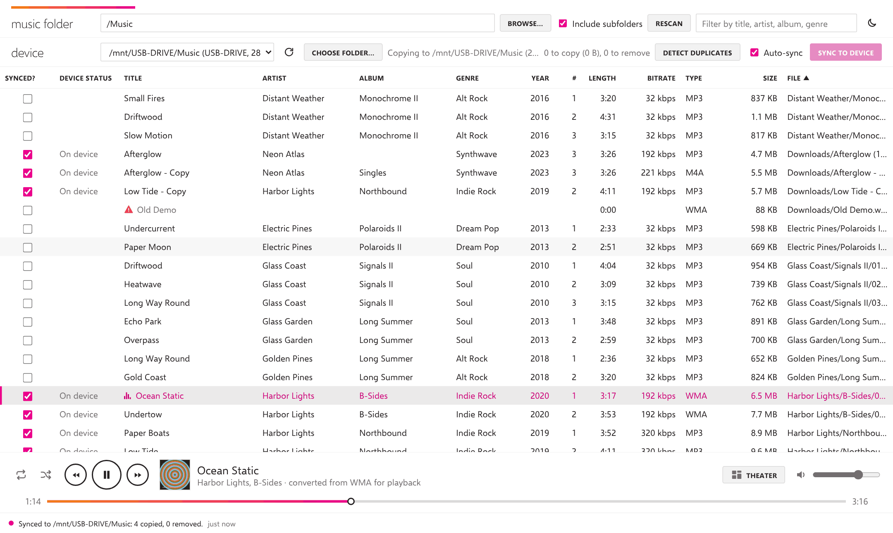
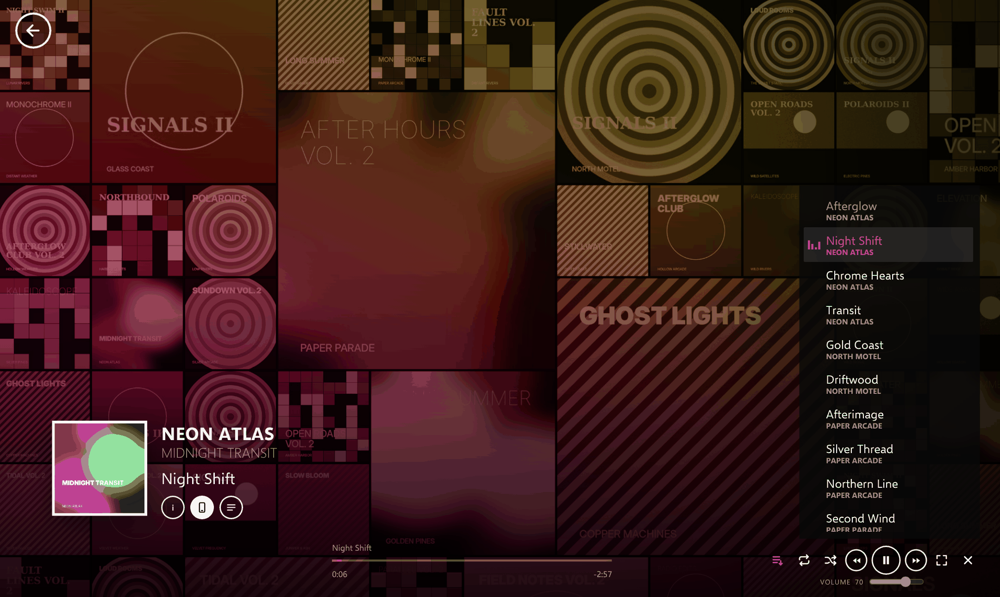
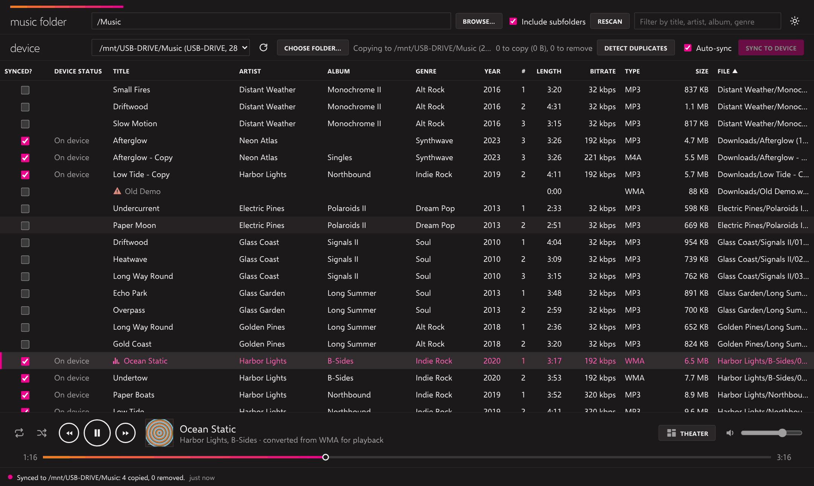
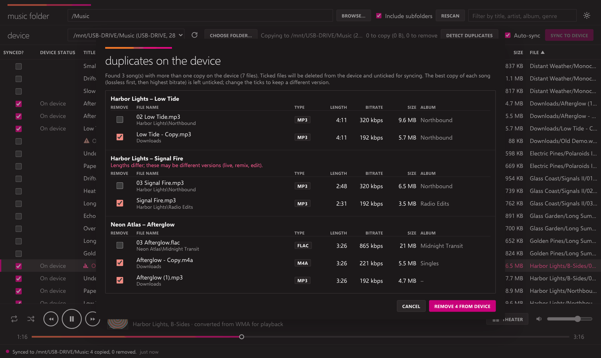
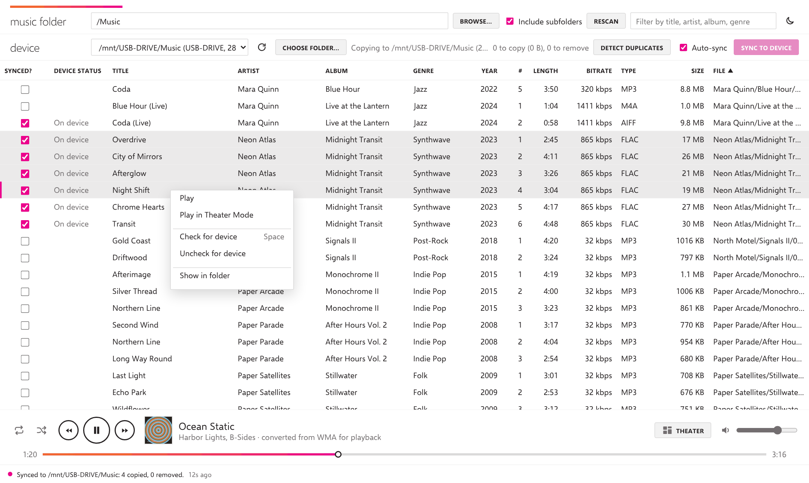
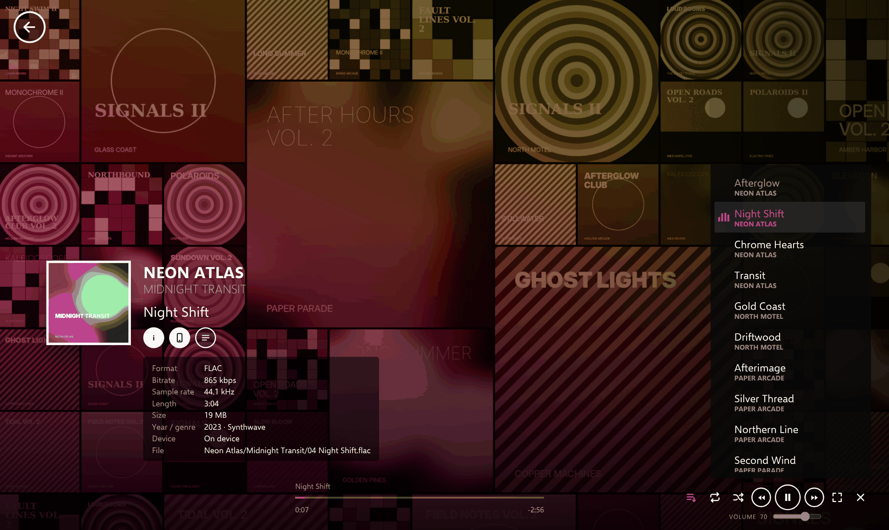
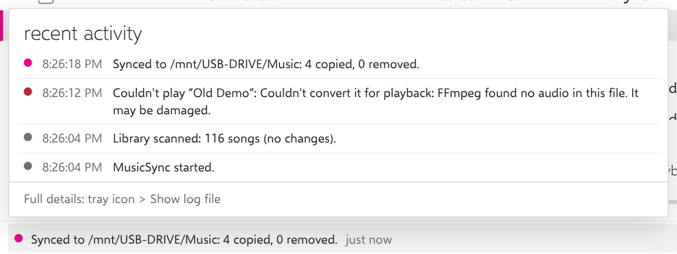
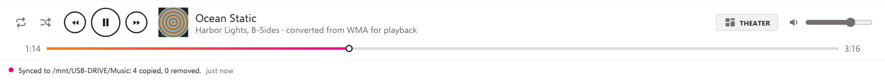

# MusicSync (local web app)

Web app created with Claude. Nothing fancy and needs some more work. A
small Python server on your PC reads your music folder, streams songs to the
page, and copies/removes songs on your external drive. It only listens on
`127.0.0.1`, so nothing else on your network can reach it.

## Screenshots

Theater mode, a full-window player over a wall of album art:

| Dark mode | Detect Duplicates |
|---|---|
|  |  |
| **Right-click menu** | **Folder picker** |
|  |  |
| **Theater mode with song details** | **Recent activity (hover the status bar)** |
|  |  |

A WMA file playing in the browser after being converted on the fly:

Player controls, with repeat on (lit, with a dot) and shuffle off:

The screenshots use a made-up demo library with generated cover art.

## Start it

1. Install **Python 3.10 or newer** from https://www.python.org/downloads/
   (the Python Install Manager or the classic installer both work).
2. Double-click **start.bat**. The first run installs the packages MusicSync
   needs into a `.venv` folder. They're bundled in the `wheels` folder, so no
   internet is needed (see "Offline install" below).
3. MusicSync starts in the **system tray** (by the clock; on Windows 11 it may
   be under the ^ arrow) and opens in your browser.
   - Click the tray icon to open MusicSync again after closing the browser tab.
   - Right-click it for **Show log file** and **Quit MusicSync**.
   - Running `start.bat` while MusicSync is already running just opens it.
   - To keep the icon always visible, drag it from under the ^ arrow onto
     the taskbar.

Prefer a console window? Use **start-console.bat** instead (Ctrl+C stops it).

Manual start on any OS:

    pip install -r requirements.txt
    pip install -r requirements-convert.txt   # optional: FFmpeg for WMA, AIFF, ALAC...
    python server.py              # tray icon
    python server.py --console    # console window

Use `MUSICSYNC_PORT=9000` to change the port, or `--no-browser` to skip opening
the browser.

## Using it

- **Music folder → Browse…** opens a folder picker. Click a column header to
  sort; type in the filter box to narrow the list. The *Type* column shows
  each file's format (MP3, FLAC, M4A, WMA…).
- **Playing:** double-click a song or press Enter. Songs play one after
  another in the list's current sort and filter order. Keyboard media keys
  work too. The controls at the bottom left: **repeat** and **shuffle**
  (they light up, with a dot underneath, when on), then previous,
  play/pause and next. Hover over a control to see what it does.
  - **Repeat** (off by default): when on, the list starts over at the end;
    when off, playback stops after the last song.
  - **Shuffle** (off by default): random order, reshuffled each time the list
    starts over.

  Formats the browser can't play are converted automatically (see "Playing
  every format").
- **Where you left off:** the playing song, position, queue, shuffle and
  repeat are saved every few seconds (and on pause, seek, song change and
  closing the page). Next time you open MusicSync, even after a crash or
  restart, that song is back in the player, paused at the same spot; press
  play to carry on. Browsers don't let a page start playing sound by itself,
  so it waits for you. Nothing is resumed once the list has played to the end.
- **Light/dark:** the sun/moon button at the top right switches themes. Until
  you use it, the app follows your Windows setting.
- **Device:** pick a drive (songs go into `X:\Music\`) or **Choose folder…**.
  The list then shows the mapped folder, and songs already there are ticked.
  The folder is remembered: if the drive isn't plugged in, the app says so and
  reconnects by itself within a few seconds of you plugging it in (or press
  the refresh button). Your ticks are kept while it's unplugged.
- **Ticking songs:** use the *Synced?* checkboxes, or highlight rows
  (Shift/Ctrl-click, Ctrl+A) and press Space. Right-click for more options.
  The *Device status* column shows **To copy**, **On device** or **To remove**.
- **Auto-sync** (on by default, next to Sync to device): a moment after you
  stop ticking or unticking, newly ticked songs are copied and unticked ones
  removed from the device. It also applies changes you made while the drive
  was unplugged, as soon as it's back. If one change would remove more than 25
  songs, it asks first; say no and it holds those removals until you press
  Sync to device. Choosing a different device doesn't start a sync by itself.
  Turn Auto-sync off to review changes and press **Sync to device** yourself.
- **Status bar:** shows progress while something runs, otherwise the latest
  activity and how long ago it happened. Hover over it (or click it) for the
  recent history: scans, syncs, files that couldn't be copied, devices
  plugged in or out, conversions and songs that wouldn't play. The full log is
  under tray icon > Show log file.

## Look and feel

The colours and type follow the 2008 Zune brand guidelines:

- **Mostly white**, with the Cool Greys (`#F2F2F2`, `#DAD9D9`, `#A09D9E`,
  `#7B7678`) and near-black Pantone 426C (`#252122`) for text.
- **Magenta** (`#EC008C`) as the accent: the playing song, toggles that are
  on, checkboxes, focus. For small text it's deepened a little (`#C8007A`) so
  it stays readable on white.
- The **orangenta** gradient (Zune Orange `#F58113` to Magenta, left to
  right) only as a small signature: the bar at the top left, dialog headings
  and the played part of the seek bar. Orange is never used on its own.
- **Segoe**: light lowercase for labels ("music folder", dialog titles),
  small bold uppercase for column headings and buttons, regular for
  everything else. Windows has Segoe UI built in. On other systems the app
  uses **Selawik**, Microsoft's free, open-licensed stand-in for Segoe UI,
  which is bundled in `static/fonts` (SIL Open Font License, included).
- **Dark mode** keeps the same rules on near-black (`#1C191A` and Pantone
  426C), with Cool Grey text and a lighter magenta for small text.

## Theater mode

A full-window player, for when the music is the point. Open it with the
**Theater** button in the player bar, **Play in Theater Mode** on the
right-click menu, or the **T** key.

- The background is a wall of your album covers in mixed tile sizes, turned
  monochrome and tinted with a colour taken from the playing song's cover. It
  drifts slowly, tiles change every few seconds, and the playing album moves
  onto a big tile when the song changes. Albums without art get lettered tiles.
- Bottom left: the cover, artist, album and title, with buttons for **song
  details** (format, bitrate, file, device status), **keep on device** (same as
  the *Synced?* tick, so Auto-sync follows) and **show in library**.
- Right: **up next**, with the playing song highlighted. Click a song to jump
  to it; the list button at the bottom right hides or shows it.
- Bottom: progress (click to seek), repeat, shuffle, previous/play/next, full
  screen, and volume.
- Keys: Space play/pause, ← → previous/next, F full screen, Esc back to the
  library.

Album art comes from the songs' tags (MP3, M4A, FLAC, OGG, WMA, APE/WavPack),
or a cover image in the album folder (`cover.jpg`, `folder.jpg`, `front.png`
and so on). Resized copies are cached on disk next to the converted files
(`%LocalAppData%\MusicSync\art\`), so each album is only read once, and the
browser keeps them for a day. The wall is sized for your whole screen, so
switching between windowed and full screen doesn't rebuild it, and it's kept
when you leave Theater mode. The cover also shows in the player bar and in
Windows' media overlay.

A song counts as on the device when a file with the same path (relative to your
music folder) and the same size is in the device folder. Only files in the
device folder are ever deleted, and the app refuses a device folder that
overlaps your music folder.

## Library index

What’s stored: each file’s size, modified time and tags, plus whether you ticked it for the device. It lives in %AppData%\MusicSync\library-index.sqlite.
On startup: your saved library appears straight away and is usable, including playback, while the folder is checked in the background.
On rescan of the same folder: only new or changed files have their tags read, and files that are gone are dropped. The status bar sums it up, for example “12,345 songs (20 new, 3 changed, 5 removed)”. In my test, a rescan with no changes read zero tags, and one with a new and a changed file read just those two.
Your ticks are saved as you make them. An unticked song still shows To remove after a restart, even if the drive wasn’t plugged in at the time.
Songs you’ve never ticked or unticked start out ticked if they’re already on the device, as before.
To rebuild the index from scratch (for example to re-read every song’s tags), quit MusicSync and delete library-index.sqlite. Your ticks are stored in it too, so they’ll be reset.

## Detect Duplicates

The button sits next to Sync to device and works whenever a device is connected.

What counts as a duplicate: songs on the device with the same song title and the same artist.
Upper/lower case is ignored, and so are copy markers at the end of a title such as (1), [2], - Copy or Copy (3), so “Hello (1)” and “Hello - Copy” count as “Hello”.
Versions such as “Hello (Live)” and years such as “Song (2021)” are kept apart.
Songs without an artist tag are skipped, since there’s nothing to compare.
Songs with the same title by different artists are left alone.
When duplicates are found: a list opens with each copy’s file name and folder, file type, length, bitrate, size and album.
The best copy in each group (lossless formats such as FLAC and WAV first, then highest bitrate, then a file name without a copy marker, then largest file) is left unticked, and the others are ticked for removal. You can change the ticks to keep a different version or file type.
If the lengths in a group differ by more than a few seconds, a note warns that they may be different versions (live, remix, edit).
If you tick every copy of a song, a warning says it will be gone from the device.
The button shows the count, for example Remove 1 from device. Pressing Cancel changes nothing.
When you confirm: the ticked files are deleted from the device and unticked in the list, so the next sync won’t copy them back. Your original files aren’t touched.
When there are none: a message says no duplicates were found.

## Playing every format

Browsers only play some audio formats natively (MP3, AAC/M4A, WAV, FLAC, and
OGG/Opus in most). For everything else, MusicSync converts the song with
**FFmpeg** when you play it, so the same files play in Chrome, Edge, Firefox
and Safari:

- WMA, AIFF, Apple Lossless (ALAC) in .m4a, APE, WavPack (.wv), Musepack
  (.mpc), TTA and DSD (.dsf) are converted automatically.
- Lossless sources become FLAC (no quality lost); lossy sources become
  320 kbps MP3.
- If a file in a "normal" format still won't play in your browser (an unusual
  codec inside, for example), a converted copy is tried before giving up.
- Conversion takes a moment the first time; the result is cached in
  `%LocalAppData%\MusicSync\converted` (up to 2 GB, oldest removed first),
  so later plays start straight away. The next song in the queue is converted
  ahead of time.
- The player shows "converted from WMA for playback" (or similar) while a
  converted copy is playing.
- Syncing is unaffected: your device always gets the original files.

### Songs that won't play

A red warning marker appears before the title of any song that couldn't be
played, even after trying a converted copy. Hover over it to see why: file not
found (moved or deleted, so rescan), file can't be read (drive busy, failing or
disconnected), file is empty, file is damaged, or the format isn't supported
and FFmpeg isn't installed to convert it. The marker disappears if the song
plays successfully later.

### Where FFmpeg comes from

FFmpeg comes from the `imageio-ffmpeg` package and is installed by
`start.bat` as an optional extra. The `wheels` folder includes the 64-bit
Windows build. If it can't be installed (e.g. ARM64 or 32-bit Windows while
offline), MusicSync still runs, and unsupported formats show the warning
marker instead. Running **get-packages.bat** on a PC with internet adds the
right build for that PC. You can also put an `ffmpeg.exe` in the app folder,
or have FFmpeg on your PATH.

`start.bat` installs the converter from the `wheels` folder, or downloads it if
it isn't there and the PC is online, and keeps trying on each start until it
succeeds. If `musicsync.log` says FFmpeg wasn't found, the reason is on the same
line, and `converter-install.log` in the app folder shows what the install did.

Note for the GitHub repo: the FFmpeg package
(`wheels/imageio_ffmpeg-0.8.1-py3-none-win_amd64.whl`) is about 39 MB. GitHub's
website only accepts uploads up to 25 MB, so add it with GitHub Desktop or
`git push` (which allow files up to 100 MB).

## Offline install

The `wheels` folder holds Flask, mutagen, pystray, Pillow and everything they
need, built for
**Python 3.15 on Windows** (64-bit, ARM64 and 32-bit), plus the optional
FFmpeg converter for 64-bit Windows. `start.bat` installs from
it automatically when it's there.

For a different Python version: on any PC with internet and that same Python
version, run **get-packages.bat**. It refills `wheels` with the right files.
Then copy the whole folder to the offline PC and run `start.bat`. Delete the
`wheels` folder if you'd rather always download from the internet.

## If start.bat can't find Python

- Open a **new** Command Prompt and run `py --version`. A Python that was just
  installed only shows up in newly opened windows (sometimes only after signing
  out and back in).
- If `where python` points into `...\WindowsApps\`, it may be the Microsoft Store
  placeholder. Go to Settings > Apps > Advanced app settings > App execution
  aliases, and turn off the `python.exe` / `python3.exe` entries labelled
  "App Installer". Leave the ones labelled "Python install manager" on.
- You can always start the app by hand with the full path to Python, e.g.
  `"C:\Path\To\python.exe" -m pip install -r requirements.txt` (and, for the
  converter, `-r requirements-convert.txt`) followed by
  `"C:\Path\To\python.exe" server.py`.

## If a sync says the server isn't answering

- Check the MusicSync tray icon is still there. If it's gone, run `start.bat`
  again.
- Security software can block or stop programs that delete files from USB
  drives. Check whether it flagged `pythonw.exe` (or `python.exe` when using
  start-console.bat), and allow it if so.
- `musicsync.log` (and `musicsync.crash.log`, if Python crashed) in the app
  folder record what happened, including the exact error for any file that
  couldn't be copied or removed.

## Notes

- File types found by the scan: MP3, M4A, AAC, WAV, FLAC, OGG, Opus, WMA, AIFF,
  APE, WavPack (.wv), Musepack (.mpc), TTA and DSD (.dsf).
- Phones that connect as "media devices" (MTP) have no drive letter, so they
  can't be chosen.
- Very large libraries are fine: only the rows on screen are drawn.
- Settings are saved in `%AppData%\MusicSync\web-settings.json`; play mode,
  volume and light/dark choice are remembered by the browser.
- Files MusicSync keeps: settings, the library index and where you left off
  (`playback.json`) in `%AppData%\MusicSync\`, converted copies for playback in
  `%LocalAppData%\MusicSync\converted\`, album art in
  `%LocalAppData%\MusicSync\art\` (safe to delete; it's rebuilt as needed),
  and `musicsync.log` in the app folder (tray icon > Show log file).
- Auto-sync, Theater mode's up-next panel and the light/dark choice are
  remembered by the browser.
